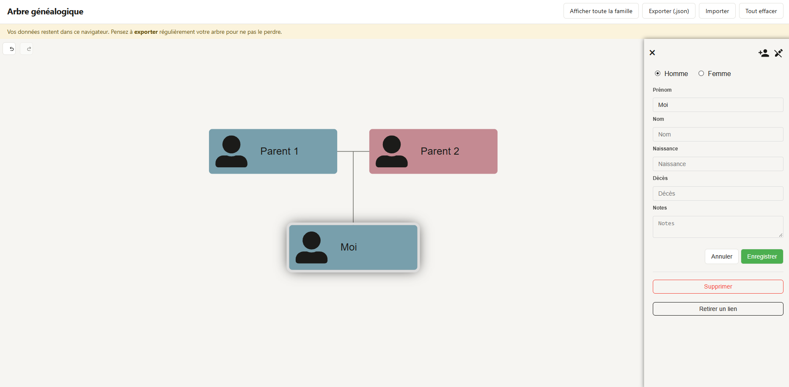

# 🌳 Arbre généalogique

Application web pour créer son arbre généalogique directement dans le navigateur.
Aucune inscription, aucun serveur : les données restent sur votre appareil.

> **Version 1** : HTML, CSS et JavaScript, sans framework ni base de données.

**[Voir la démo en ligne](https://xznoow.github.io/arbre-genealogique/)**



## Fonctionnalités

- Ajouter, modifier et supprimer des personnes (prénom, nom, naissance, décès, notes)
- Relier les personnes : parents, conjoints, enfants
- Dates en texte libre (`12/03/1921`, `vers 1850`, `avant 1900`…)
- Sauvegarde automatique dans le navigateur (`localStorage`)
- Export et import de l'arbre au format JSON

## Structure

```
index.html        Page principale
404.html          Page d'erreur
assets/style.css  Styles de l'application
js/main.js        Création de l'arbre, édition, boutons
js/data.js        Sauvegarde dans le navigateur + validation des données
js/fichiers.js    Export / import JSON
```

## Format des données

Chaque personne suit le format de [family-chart](https://github.com/donatso/family-chart) :

```json
{
  "id": "moi",
  "data": { "gender": "M", "prenom": "Antoine", "nom": "Dupont", "naissance": "2007" },
  "rels": { "parents": ["id-du-pere"], "spouses": [], "children": [] }
}
```

## Technologies

- [family-chart](https://github.com/donatso/family-chart) 0.9 (basé sur [D3.js](https://d3js.org/)) pour l'affichage de l'arbre
- HTML, CSS, JavaScript (modules ES)

## Feuille de route

- [x] Création et édition de l'arbre, sauvegarde locale
- [x] Export / import JSON
- [ ] Recherche d'une personne
- [ ] Photo de profil
- [ ] Export GEDCOM
- [ ] Mise en ligne
- [ ] Version 2 : comptes utilisateurs et partage d'arbres
